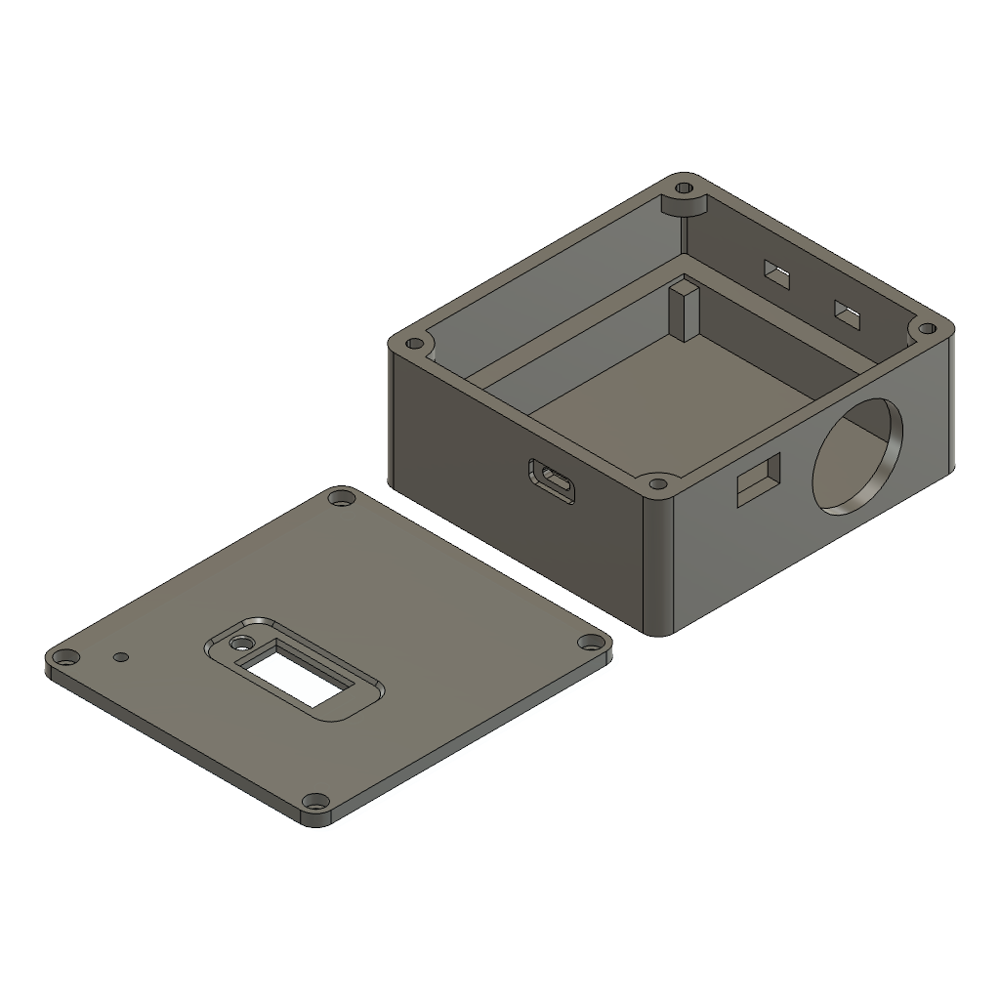

# ColdTrace

A battery-backed fridge/freezer monitor built on an STM32F446RE with register-level (no HAL) firmware. It reads temperature and door state, sounds a local alarm, keeps an hourly min/max/average history on an SD card, and posts to a small Flask server for a live dashboard and a per-day history graph. If WiFi drops, the missed hours are uploaded automatically when it comes back.



**Status:** v1 built and tested on the bench; field install in progress. v2 (OTA updates, smaller board, alerts) is planned, see [Roadmap](#roadmap).

> ColdTrace is a monitoring aid, not a certified food-safety instrument. Keep doing your normal manual temperature checks.

## What it does

- **Temperature and door monitoring:** DS18B20 probe plus a reed switch on the door.
- **Local alarm:** a red LED and buzzer when the temperature stays over the threshold for the alarm delay (15 minutes by default), which rides out defrost cycles and door-open spikes.
- **Door alarm:** the door-open LED flashes amber, flashes faster after one minute, and a short beep repeats every 5 seconds.
- **Mute button:** short press mutes 15 minutes, hold 3 seconds mutes 12 hours, press while muted cancels. It boots muted for 15 minutes.
- **OLED status screen:** big temperature, clock, WiFi and SD icons, and a mute icon with time left.
- **Hourly history on SD:** one 16-byte record per hour (min, max, average, door-open time).
- **Live dashboard:** a reading every 5 seconds, plus a per-day graph of hourly min/avg/max with a door strip.
- **Outage catch-up:** the server reports the newest hour it has; the device uploads every newer hour from the SD.
- **Remote settings:** timezone offset, alarm threshold and alarm delay are set on the server's `/admin` page and picked up by the device, no reflash needed.
- **Watchdog:** an independent hardware watchdog resets the board if the main loop ever stalls.

### Lights and sounds

| State | LED | Sound |
|---|---|---|
| All fine | green blip every 5 s | none |
| Door open | amber (red + green) flashing slowly | none |
| Door open over 1 minute | amber flashing fast | short beep every 5 s |
| Temperature alarm | red flashing | buzzer |
| Temperature alarm, muted | red flashing slowly | none |

A temperature alarm takes priority over the door indicator. A one-page guide for end users is in [`docs/owner-guide.html`](docs/owner-guide.html).

## How it fits together

```
 DS18B20 probe ─┐
 Reed switch ───┤                    ┌── I2C ── SSD1306 OLED
 Mute button ───┼── STM32F446RE ─────┼── I2C ── DS3231 RTC
 Red/green LED ◄┤   (bare metal)     ├── SPI ── microSD (hourly history)
 Buzzer ◄───────┘                    └── UART ─ ESP-01S ─ WiFi ─▶ Flask server
                                                                   ├ /dashboard  live
                                                                   ├ /history    per-day graph
                                                                   └ /admin      timezone, threshold
```

### Hardware

WeAct STM32F446RE core board. Schematic: [PDF](hardware/kicad/coldtrace_schematic.pdf), KiCad project in [`hardware/kicad/`](hardware/kicad/). Case: [`hardware/case/`](hardware/case/).

| Part | Pins | Notes |
|---|---|---|
| DS18B20 | PC0 | 1-Wire, external pull-up |
| ESP-01S | UART4: PC10 TX, PC11 RX | 115200 8N1, own 3.3 V supply |
| DS3231 RTC | I2C3: PA8 SCL, PC9 SDA | time is synced from the server |
| SSD1306 OLED | I2C1: PB8 SCL, PB9 SDA | |
| microSD | SPI1: PA5 SCK, PA6 MISO, PA7 MOSI, PB12 CS | raw blocks, no filesystem |
| Red / green LED | PC5 / PB1 | one bicolor LED, amber = both |
| Buzzer | PB4 | through a 2N3904 |
| Reed switch | PC13 | external pull-up, low = door closed |
| Mute button | PC3 | EXTI3, internal pull-up |

Power: TP4056 charger and battery, MT3608 boost to 5 V, LM2596 buck to 3.3 V for the ESP.

Timers: TIM2 (1-Wire and ESP timeouts), TIM3 (I2C timeouts), TIM4 (loop pacing), TIM5 (SPI timeouts), SysTick (1 ms clock), IWDG (watchdog).

### Firmware

`App_Init` brings up the peripherals, joins WiFi, syncs the RTC from the server's `Date` header, and brings up the SD card. `App_Loop` runs about once a second:

1. Read the RTC and the door, update the LEDs.
2. Convert and read the DS18B20 (CRC-checked), redrawing the OLED right away.
3. Fold the reading into the current hour; a finished hour is queued, saved to the SD, then uploaded.
4. Every 5 seconds, post the live reading, then send up to 3 saved hours the server is missing.
5. The button is handled on an interrupt; the blocking ESP waits call back into the app so the LEDs, button and watchdog stay serviced.

Notes on the design:

- **No HAL in the application or drivers.** The 1 ms clock is a plain SysTick counter. The CubeIDE project still carries ST's HAL sources, but nothing uses them and the Makefile build leaves them out.
- **ESP8266 replies are matched with a constant-cost tail check**, not `strstr` per byte, which would overrun the 115200-baud UART on this clock.
- **Time-based patterns:** LED and buzzer phases are computed from the millisecond clock, so a slow SD write or network call can't freeze them.
- **Server-driven catch-up:** nothing about "what is uploaded" is stored on the device; the server's `X-Last-Hour` header decides.

### SD card format

No filesystem. Block 0 holds a magic number (`HRLY`) and the record count; records start at block 1, 32 per block:

```
u32 key (yymmddhh, local time) | i16 min | i16 max | i16 avg (x100 °C) | u16 door samples | u16 samples | u16 marker
```

### Server

A small Flask app in a separate repo, [coldtrace-server](https://github.com/M4K1S/coldtrace-server), deployed on PythonAnywhere.

| Route | Purpose |
|---|---|
| `POST /api/reading` | live reading from the device |
| `POST /api/hourly` | one finished hour (live or catch-up) |
| `GET /api/data` | latest data; its headers carry `X-Tz-Offset`, `X-Alarm-Threshold`, `X-Alarm-Delay`, `X-Last-Hour` |
| `GET /dashboard`, `GET /history?day=YYMMDD` | live view and per-day graph |
| `/admin` (password) | set timezone offset, alarm threshold and alarm delay |

## Build and flash

You need the Arm GNU toolchain (`arm-none-eabi-gcc`) on your `PATH`; STM32CubeIDE bundles one.

```bash
git clone --recurse-submodules https://github.com/M4K1S/coldtrace.git
cd coldtrace
cp Core/Inc/secrets.example.h Core/Inc/secrets.h   # then edit: WiFi name, password, server host
make                                               # builds build/BareMetal.elf and .bin
st-flash write build/BareMetal.bin 0x8000000       # or flash with CubeIDE / STM32CubeProgrammer
```

`make OPT=-O2` builds optimised; the default matches the IDE's Debug configuration. You can also open the folder as a STM32CubeIDE project. `secrets.h` is gitignored and never committed.

If you cloned without `--recurse-submodules`, run `git submodule update --init`. The driver library is [stm32-baremetal-drivers](https://github.com/M4K1S/stm32-baremetal-drivers), pinned to a specific commit on purpose.

## Repository layout

```
Core/            application (app.c main logic, log.c hourly SD records)
BareMetalDrivers/  register-level drivers (submodule)
hardware/kicad/  schematic
hardware/case/   Fusion design, STEP, STL, print notes
docs/            owner guide
Makefile         command-line build
```

## Limitations

- A power cut loses the hour in progress (up to 59 minutes); finished hours are safe on the SD.
- If the clock is wrong at boot, hours are recorded under the wrong date until the next time sync.
- An upload counts as delivered once the ESP sends it, not when the server confirms; a miss is repaired at the next boot or reconnect.
- WiFi credentials are compiled in, so changing networks means reflashing.
- There is no automated test suite in the repo yet; the logic was checked with host-side simulations.

## Roadmap

v2 plans: OTA firmware updates, a single smaller board (ESP32), WiFi setup without reflashing, push or email alerts when the temperature is high or the device goes offline, a daily temperature log export, and a second probe.

## License

MIT, see [`LICENSE`](LICENSE).
